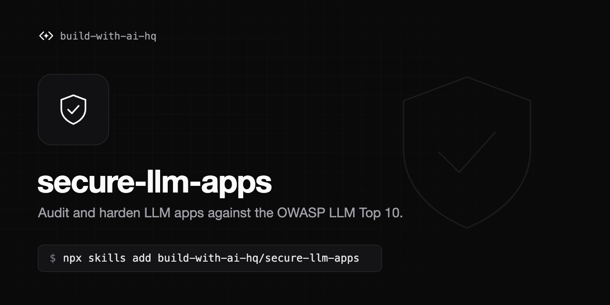

# secure-llm-apps

[](https://skills.sh/build-with-ai-hq/secure-llm-apps)

An Agent Skill that audits and hardens LLM-powered apps and agents against the practical OWASP LLM Top 10 risks, with Python and TypeScript fixes.

## Problems this solves

- Provider API keys shipped in a browser bundle, mobile app, notebook or git history.
- Direct and indirect prompt injection through user input, RAG documents, emails, tickets, web pages and tool results.
- Agents and MCP servers with more tools than they need, and destructive actions running without a human in the loop.
- PII and pasted credentials sent to model providers.
- LLM output flowing unescaped into SQL, HTML/markdown, shell commands or `eval`.
- Unbounded token spend: no per-user limits, no budgets, runaway agent loops.
- Prompts, completions and auth headers ending up in logs and traces.
- A self-hosted AI gateway or MCP endpoint reachable without auth.

## Install

```bash
npx skills add build-with-ai-hq/secure-llm-apps
```

## What the skill does

When an agent loads this skill, it:

1. Runs a grep-based audit of the codebase for leaked keys, dangerous output sinks, tool definitions, missing limits and content logging.
2. Prioritizes findings by impact: key exposure, untrusted content reaching tools, over-broad agency, output handling, data leakage, consumption, logging.
3. Applies concrete fixes: server-side key handling, untrusted-content delimiting and taint tracking, least-privilege tool dispatch with human approval, pydantic/zod output validation, output encoding, local PII redaction with Microsoft Presidio, secret masking, per-user rate limiting, and metadata-only logging.
4. Moves controls that are stronger when enforced centrally to an open-source gateway (Bifrost): virtual keys so apps never hold provider keys, per-key model allowlists, per-key MCP tool allowlists, rate limits and budgets, content-free logs, and a locked-down gateway deployment.
5. Verifies each fix with specific tests, including injection payloads and abuse scripts.

## Contents

```
SKILL.md                         Core workflow: diagnosis, fixes in priority order, gateway controls, verification
references/prompt-injection.md   Threat model, taint tracking, quarantine pattern, exfiltration channels, MCP risks, test payloads
references/keys-and-gateway.md   Key placement, leaked-key runbook, virtual keys, MCP tool allowlists, gateway lockdown
references/pii-and-data.md       Presidio redaction and pseudonymization (Python + TS), secret masking, tenant isolation, logging hygiene
references/audit-checklist.md    Full grep list and a checklist mapped to OWASP Top 10 for LLM Applications, report template
```

## License

MIT. See [LICENSE](LICENSE).
